<p align="center">
  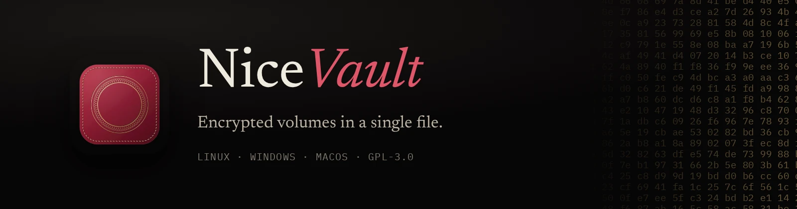
</p>

NiceVault keeps your files in an encrypted volume. A volume is one file with the extension `.nvault`: you can copy it, back it up, put it in a synced folder or carry it on a USB stick. You open it with a password and browse it in a built-in file manager. Linux and Windows are the supported desktop systems; macOS builds but is not fully tested. iOS and Android are in development and are not on the App Store or Google Play yet (see [Platform status](#platform-status)). If the operating system allows it, you can also mount it as a normal drive.

It is meant for people who move sensitive files between machines (scans, contracts, photos, key files, recovery codes) and want something closer to a VeraCrypt container than to a cloud service, without installing a driver or needing administrator rights to look at their own files.

<p align="center">
  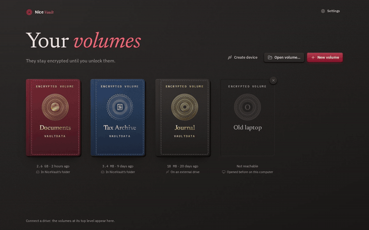
</p>

## What makes it different

- **One file per volume.** No container plus side files. New volumes keep their journal inside the file, so the volume you copy is the whole volume.
- **It travels with a stick.** NiceVault can prepare a USB drive with two partitions: one holds the program for Windows, macOS and Linux, the other holds your volumes. Plug it into any of those systems, start the program from the stick, unlock. Nothing is installed on the host.
- **It does not need a driver.** The built-in file manager decrypts on the fly and previews files in memory. Mounting as a drive (FUSE on Linux, a local NFS share on macOS, WinFsp on Windows) is optional.
- **It survives pulling the plug.** Writes go through a database transaction. After a crash or a yanked drive the volume opens in its last committed state; at most the last few seconds of work are lost, never half a file.
- **It has a password manager inside.** Entries live in the same encrypted database as your files, with one-time codes (TOTP), a generator and imports from other managers.
- **Phones are on the way.** The same app and the same volume format are being built for iOS and Android, with a phone layout. Neither is released.

## Screenshots

<table>
  <tr>
    <td width="50%">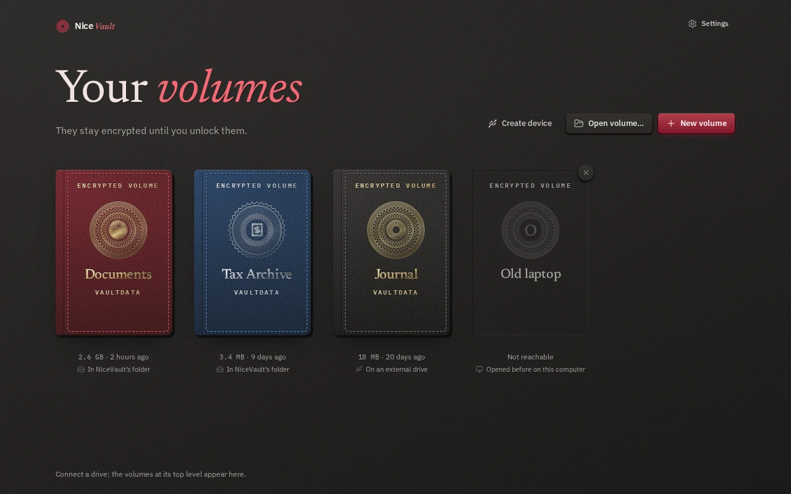</td>
    <td width="50%">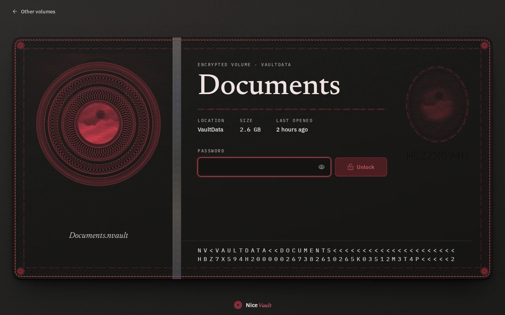</td>
  </tr>
  <tr>
    <td align="center"><sub>Volumes are listed as passports. Each one can carry its own colour and emblem, even while locked.</sub></td>
    <td align="center"><sub>Unlocking. The volume stays opaque until the password is right.</sub></td>
  </tr>
  <tr>
    <td>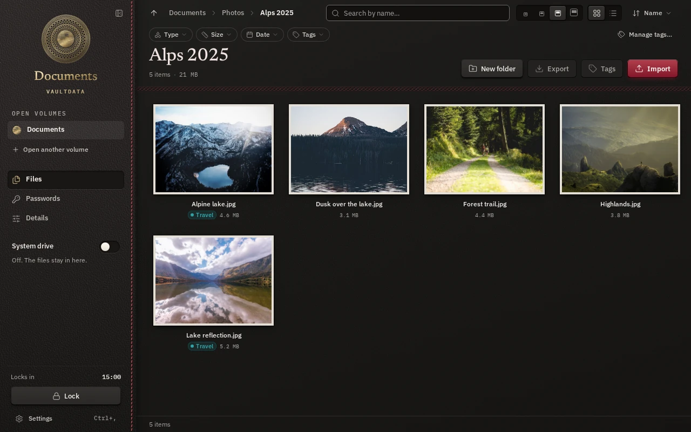</td>
    <td>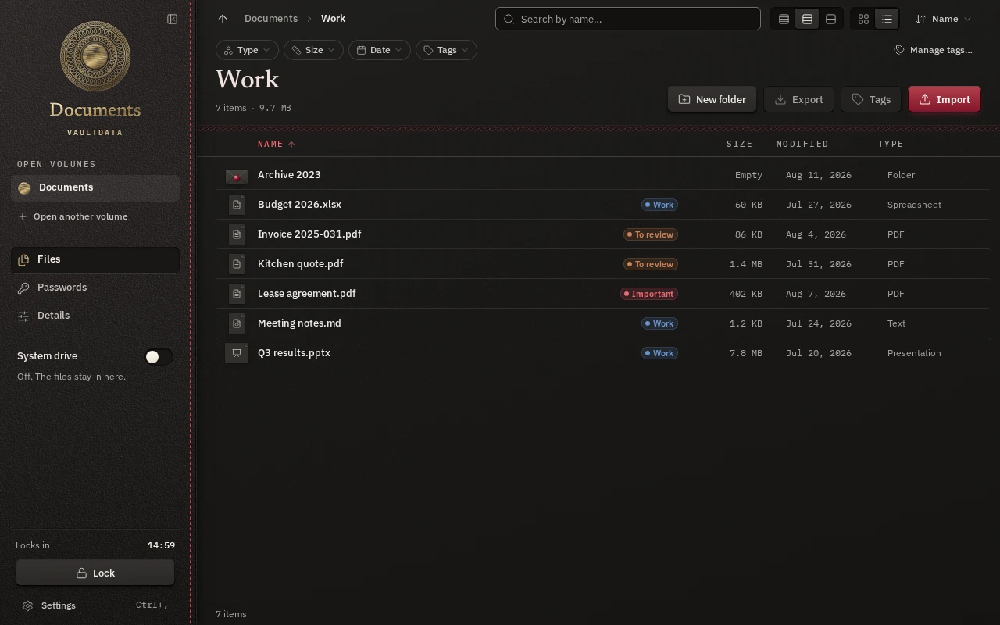</td>
  </tr>
  <tr>
    <td align="center"><sub>Grid view with thumbnails and tags.</sub></td>
    <td align="center"><sub>List view.</sub></td>
  </tr>
  <tr>
    <td>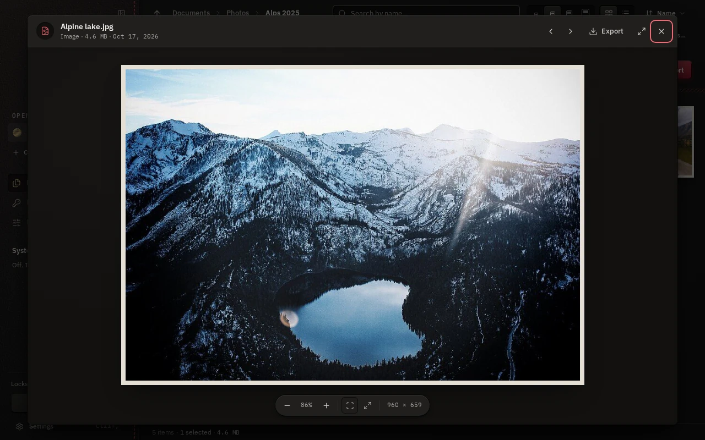</td>
    <td>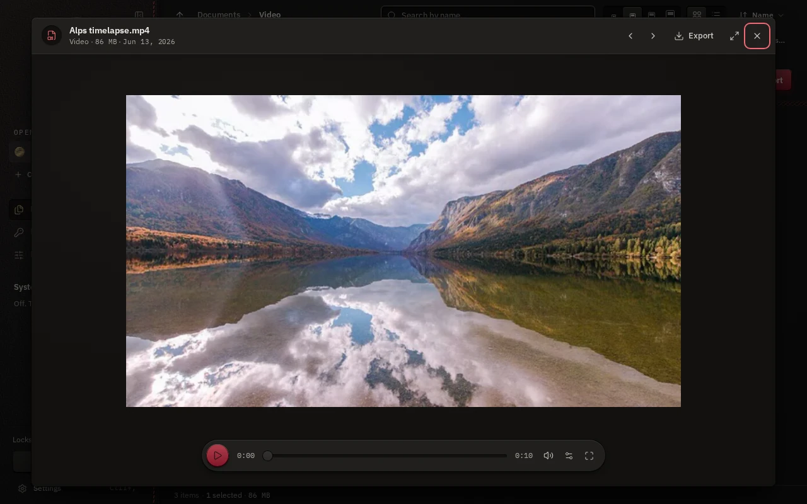</td>
  </tr>
  <tr>
    <td align="center"><sub>Quick look: images with zoom, ...</sub></td>
    <td align="center"><sub>... audio and video streamed from the volume, nothing written to disk.</sub></td>
  </tr>
  <tr>
    <td>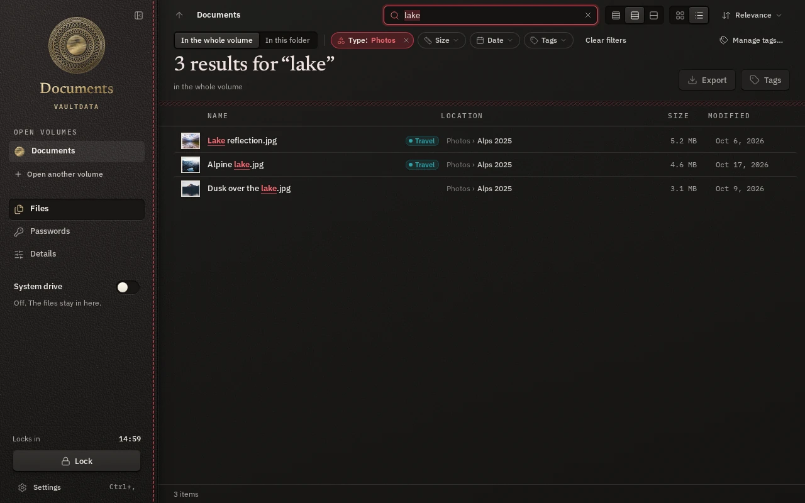</td>
    <td>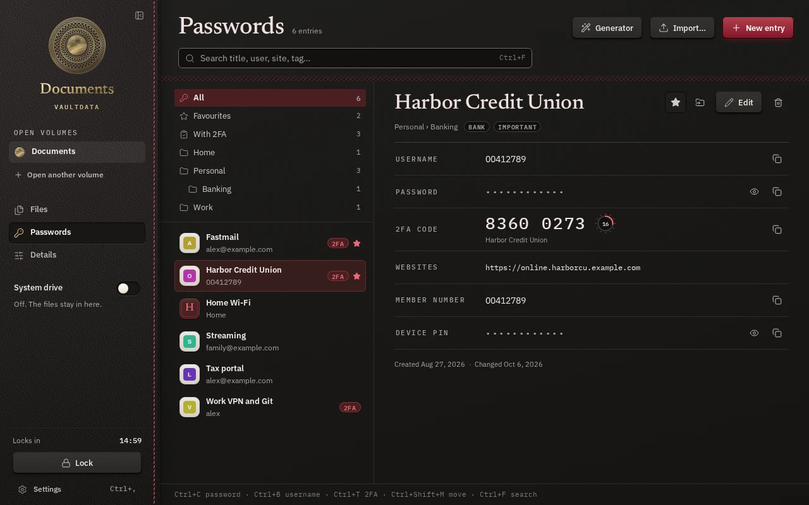</td>
  </tr>
  <tr>
    <td align="center"><sub>Search by name, with filters for type, size, date and tags.</sub></td>
    <td align="center"><sub>The password manager, with TOTP codes.</sub></td>
  </tr>
  <tr>
    <td>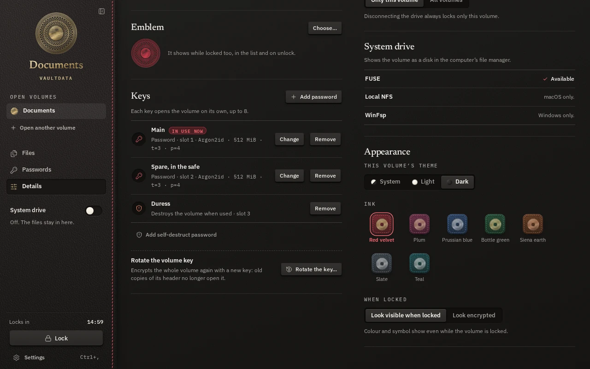</td>
    <td>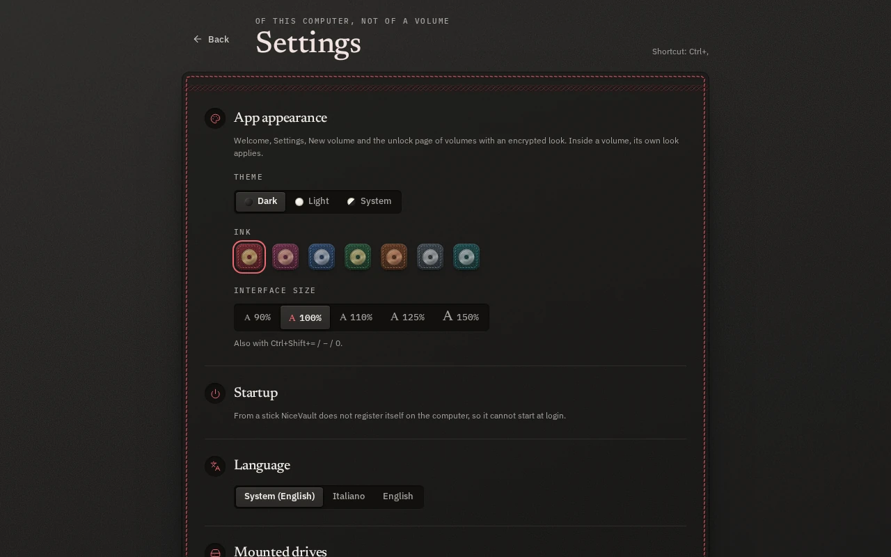</td>
  </tr>
  <tr>
    <td align="center"><sub>Keys, the self-destruct password and key rotation.</sub></td>
    <td align="center"><sub>App settings: theme, ink, interface size, language.</sub></td>
  </tr>
</table>

### Making a NiceVault device

<p align="center">
  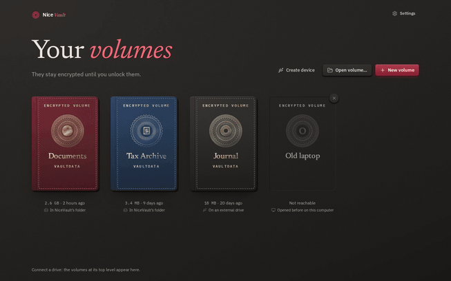
</p>

The wizard lists external drives only, shows exactly what will be erased, and asks you to type the drive's name before it does anything.

### Light theme

<table>
  <tr>
    <td width="50%">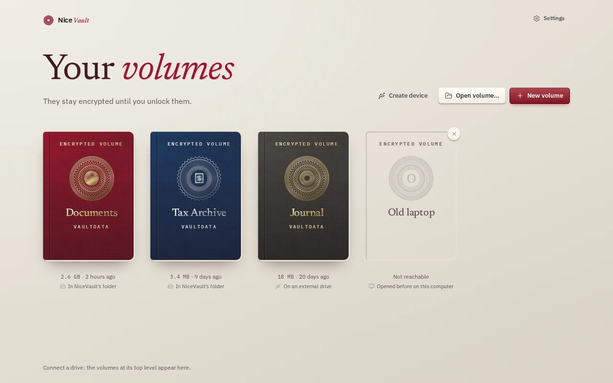</td>
    <td width="50%">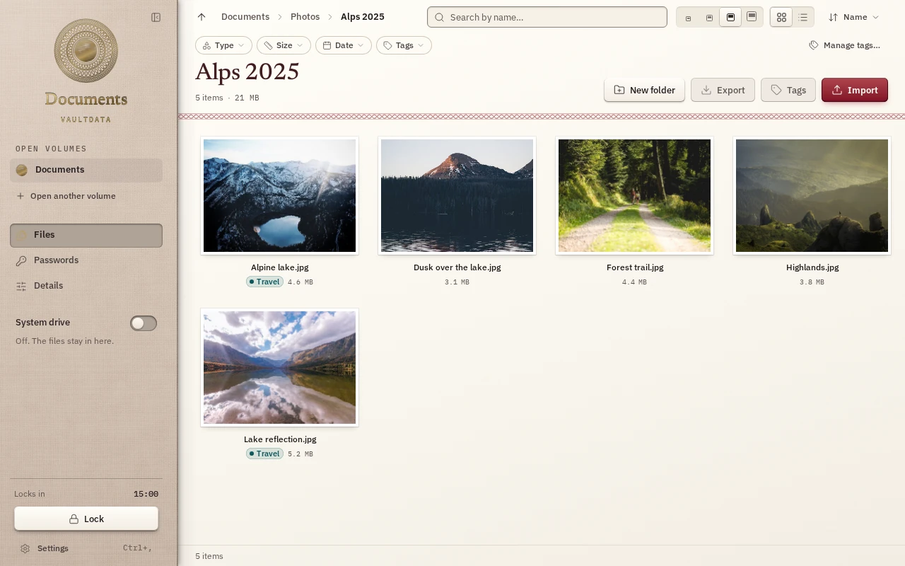</td>
  </tr>
</table>

### Phone (in development)

<table>
  <tr>
    <td width="25%">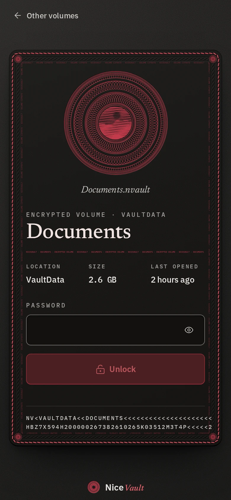</td>
    <td width="25%">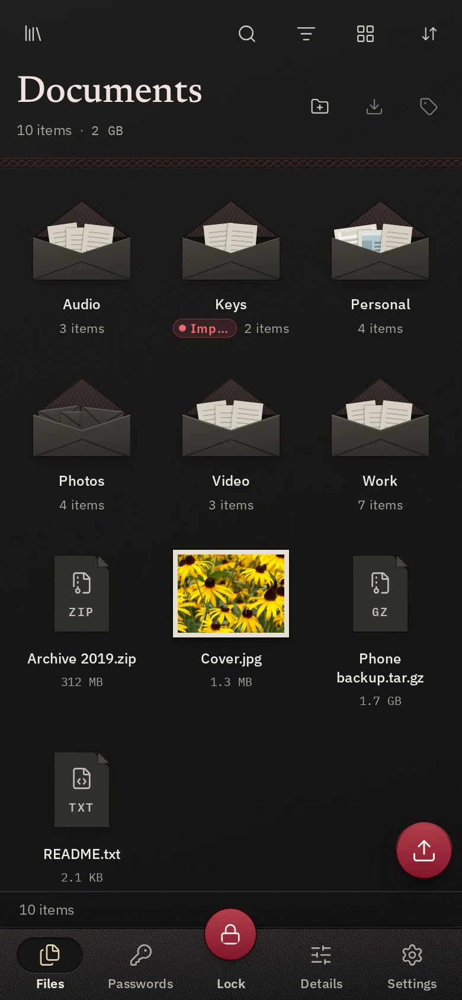</td>
    <td width="25%">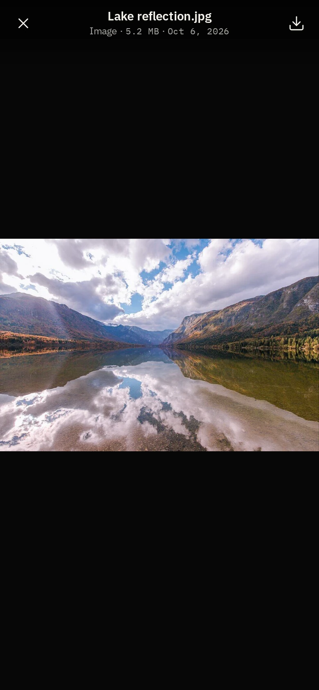</td>
    <td width="25%">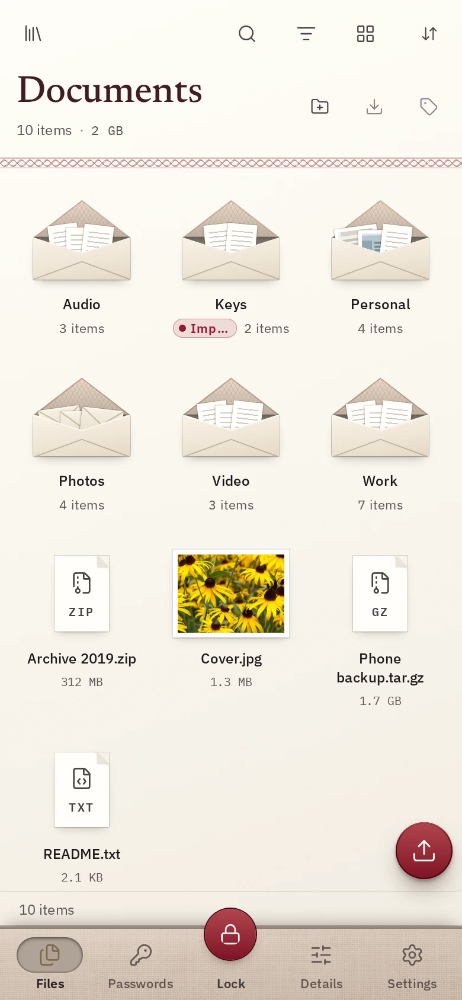</td>
  </tr>
</table>

<p align="center">
  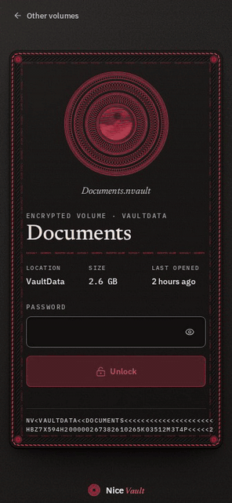
</p>

The screenshots come from the app running against an in-memory demo backend. The sample photographs are CC0.

## Features

**Volumes and keys**

- Up to 8 keys per volume. Each key is its own password and can be changed or removed without touching the others.
- A *duress password*: typed at the unlock screen, it destroys the keys in the volume header and then fails like any wrong password.
- *Rotate the volume key*: re-encrypts the volume under a new master key, so old copies of the file stop opening with an old password.
- Fixed-size volumes that preallocate their whole file, and can be extended or shrunk later.
- Auto-lock after an idle time, when the computer sleeps, when the screen locks, or when the drive disappears. Per volume or for all volumes.
- Optional appearance per volume: a colour and an emblem shown on the locked screens, or none at all.

**Files**

- Built-in file manager: grid and list views, several icon sizes, drag and drop to import, import and export as background jobs with progress and cancel, move, rename, delete.
- Search by name over the whole volume or one folder, with filters (type, size, date) and coloured tags.
- Quick look for images (zoom and pan), audio and video, PDF, text and source code with syntax colouring, Markdown, CSV, Word/Excel/PowerPoint and OpenDocument files (text only), zip and tar archives, and a hex view for everything else. All of it is decrypted in memory.
- Mount as a drive: FUSE on Linux, a loopback NFS server on macOS, WinFsp on Windows.

**Password manager**

- Logins with notes, custom fields, folders, tags and password history.
- TOTP codes, a password and passphrase generator, a clipboard that clears itself.
- Import from Bitwarden (JSON), KeePass (KDBX 3.1 and 4) and CSV exports of the common browsers and managers.
- Site icons are optional and fetched only from the site itself.

**Devices and phones**

- *Create device*: partitions a USB stick or external disk into a small `NiceVault` partition (the programs for the three desktop systems, with signatures) and a `VaultData` partition for your volumes, in exFAT, NTFS, ext4, btrfs or APFS. Later, one click brings the programs on the stick up to date.
- iOS and Android (in development, not released): the same volumes and features, a bottom navigation, camera roll import, share sheet, and a cover over the app in the app switcher.

**The rest**

- English and Italian interface, dark and light themes, seven colour inks.
- No telemetry. The app goes online only to check for updates (switchable), to download the programs when you make a device, and, if you leave it on, to fetch site icons for the password manager.

## How it works

### The file

A `.nvault` file starts with two copies of a 64 KiB header, followed by a SQLite database. The database is encrypted with SQLCipher. Folders, file names, file contents (stored in 256 KiB chunks), tags and password-manager entries are all rows in that database, so none of them is visible outside it.

The header copies are written one after the other, with a sync in between, so one copy is valid at every instant. A checksum catches a torn copy, and a keyed MAC checked after unlock catches tampering. The volume format is append-only: a build never changes what an older volume means, and every release has to open a set of volumes written by earlier builds.

### Keys

1. Creating a volume draws a random 32-byte master key.
2. Each password slot stretches its password with **Argon2id** and a random 32-byte salt into a key-encryption key, and wraps the master key with **XChaCha20-Poly1305**. The slot index and kind are bound into the wrap as associated data.
3. The default Argon2id setting uses up to 512 MiB of memory (less on a machine with little free RAM), 4 lanes, and an iteration count measured on the machine that creates the volume so that one unlock takes about 0.7 seconds. The parameters are stored in the header, and a header asking for more than 1 GiB, 64 passes or 16 lanes is refused.
4. The database key is `HKDF-SHA256(master, "nv sqlcipher")`, handed to SQLCipher as a raw key. SQLCipher 4 encrypts each 16 KiB page with **AES-256-CBC** and authenticates it with **HMAC-SHA256**. The SQLCipher settings are pinned in the code and covered by compatibility tests.
5. Every read is followed by a check that no page failed its HMAC, so a damaged page cannot silently read back as zeros.

The header also supports slots for public keys, using a hybrid of X25519 and ML-KEM-768 (a post-quantum KEM). That works in the core library. The app does not expose it yet, so today sharing a volume means sharing a password. Data at rest is protected by symmetric 256-bit keys only.

### What the app does with the keys

The master key sits in memory locked against swapping (where the OS allows it) and is wiped when the volume locks. Core dumps are disabled. Previews are decrypted into memory and are not written to disk. On Linux, audio and video larger than 32 MB are served to the web view from a loopback server that accepts only your own user, one random ticket per file, and the player is set up so that WebKitGTK does not buffer the stream to `/var/tmp`. That last part rests on WebKitGTK internals; a real-app test checks it and should be rerun after a WebKitGTK upgrade. "Open with an external app" does write a decrypted copy, on a memory-backed directory on Linux and in the temp folder elsewhere, and wipes it afterwards on a best-effort basis.

Deleting a file overwrites the freed pages inside the volume (SQLCipher's `secure_delete`). On an SSD or a copy-on-write file system the host may still keep older copies of those sectors.

### What is protected, and what is not

Protected, against someone who has the file but not the password: file contents, names, sizes, the folder tree, tags, notes and everything in the password manager.

Not protected, or only partly:

- **The file is recognisable.** It starts with fixed magic bytes. There are no hidden volumes and no plausible deniability.
- **Some header fields are plaintext:** the format version, a random volume id, the number of key slots, the Argon2id parameters, and, with the default "visible when locked" look, the accent colour and a small emblem. Choose the encrypted look and the last two are not stored in the clear.
- **The size of the file.** A fixed-size volume hides how full it is from the file system, but not from someone reading the bytes.
- **An unlocked volume.** While it is open, the key is in the memory of the app, and a mounted drive is readable by your other programs. Malware on the computer at that moment wins.
- **Old copies.** Changing or removing a password does not change the master key. Anyone with an old copy of the file and the old password can still open that copy; rotate the volume key to cut it off. The duress password destroys the keys of one file only, and cannot help against a copy made earlier.
- **Rollback.** Replacing a volume with an older copy of itself cannot be detected from the file alone. The app keeps a counter per volume on the computer (in installed mode) and warns when a volume opens older than it was. A fresh computer or a portable session has no counter.
- **No third-party audit.** The code has had an internal security review and the findings were fixed or documented. It has not been audited by anyone outside the project.

## Download

Linux: `NiceVault-linux-x86_64.AppImage`, from the releases page of this repository on GitHub. Make it executable and run it. Releases will be published there; the other platforms will be added as they are ready. Binaries are not code-signed.

## Platform status

| Platform | State |
| --- | --- |
| Linux (x86_64) | Main development platform. File manager, FUSE mount (needs `fusermount3`), device creation through udisks2. Released as an AppImage. |
| Windows (x86_64) | Builds as a single `.exe` and uses the system WebView2. Mounting needs WinFsp installed. Device creation goes through a UAC prompt. |
| macOS (universal) | Builds as an ad-hoc signed `.app`, not notarized, so Gatekeeper needs a manual approval. Mounting uses the built-in NFS client. Not fully tested. |
| iOS | In development. Not on the App Store; test builds are sideloaded. |
| Android | In development. Not on Google Play; a debug APK builds and runs on the emulator. |

Not done yet: public-key sharing in the app, hidden volumes, FIDO2 keys, a browser extension for the password manager.

## Build from source

You need Rust (stable, edition 2024), Node.js 20.19 or newer (22.12 or newer on the 22 line) with [pnpm](https://pnpm.io), a C compiler and Perl. SQLCipher is built together with a vendored OpenSSL, and OpenSSL's build wants a full Perl (on Fedora: `perl-core`). On Linux you also need the [Tauri 2 prerequisites](https://v2.tauri.app/start/prerequisites/) (WebKitGTK 4.1, GTK 3) and `fuse3` at runtime if you want to mount volumes.

```sh
pnpm --dir app/ui install --frozen-lockfile
pnpm --dir app/ui build                  # the UI, embedded into the binary
cargo build --release -p nicevault-app   # target/release/nicevault (a debug build lands in target/debug)
```

Run the app against a real backend with live reload: `pnpm --dir app/ui tauri dev`.

The UI also runs in a plain browser against an in-memory mock of the backend, which is how the screenshots above are made:

```sh
pnpm --dir app/ui dev                    # http://localhost:5173
pnpm --dir app/ui shots                  # regenerates docs/media (needs Chromium and ffmpeg)
```

Tests:

```sh
cargo test --workspace
cargo clippy --workspace --all-targets -- -D warnings
pnpm --dir app/ui check
pnpm --dir app/ui test
pnpm --dir app/ui e2e                    # Playwright against the mock backend
```

Cross builds for Windows and macOS from Linux, and the Android and iOS builds, are described in [scripts/BUILD.md](scripts/BUILD.md).

## Repository layout

| Path | What is in it |
| --- | --- |
| `crates/nv-fs` | The `Fs` trait: the contract between the volume, the mount backends and the app. |
| `crates/nv-core` | Volume format, keys, SQLCipher store, password manager, search. |
| `crates/nv-mount` | Exposes any `Fs` as a drive: FUSE, NFS, WinFsp. |
| `app/src-tauri` | The Tauri 2 shell: commands, jobs, viewers, device creation, updater. |
| `app/ui` | The Svelte 5 interface, its translations and the end-to-end tests. |

## License

NiceVault is free software under the GNU General Public License, version 3 or later. See [LICENSE](LICENSE).

The bundled fonts are under the SIL Open Font License, and third-party code keeps its own license (see `third_party/`).
