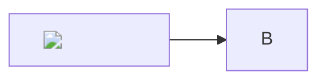

# Nota sospetta

<iframe src="https://evil.example/"></iframe>
<form action="https://evil.example/"><input name="p"></form>
<svg onload="alert(1)"><circle r="5"/></svg>

<a href="javascript:alert(1)">ancora</a>

[link pericoloso](javascript:alert(1)) · [vbscript](vbscript:msgbox(1)) · [file](file:///etc/passwd)
[dati](data:text/html;base64,PHNjcmlwdD5hbGVydCgxKTwvc2NyaXB0Pg==) · [credenziali](https://user:pw@evil.example/)
[mailto con allegato](mailto:a@b.it?attach=/etc/passwd) · <javascript:alert(1)>

[riferimento]: javascript:alert(2)

Un [riferimento][riferimento] e un'intestazione con id: <h1 id="app">x</h1>

$\href{javascript:alert(1)}{clic}$ e $\htmlStyle{color:red}{rosso}$ e $\url{https://evil.example}$

