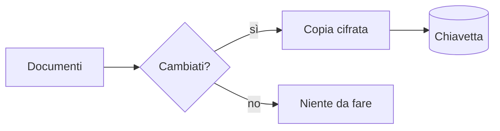

# Taccuino di casa

Questo taccuino raccoglie le **cose da sapere** sulla casa: *scadenze*, ~~vecchie~~ note,
==promemoria evidenziati== e qualche formula. Il sito ufficiale è https://nicevault.app,
oppure leggi [la pagina di aiuto](https://example.org/aiuto "Aiuto"). Scrivi a <mailto:anna@example.org>.

Una nota a piè di pagina[^1] e un'altra più lunga[^note]. L'H~2~O bolle a 100 °C, 2^10^ = 1024.
Un po' di emoji: :tada: :key: :house:. La CPU di casa è un vecchio NAS.

*[CPU]: Central Processing Unit
*[NAS]: Network Attached Storage

> [!NOTE]
> Le password restano qui dentro, non nelle email.

> [!TIP]
> Esporta un backup ogni mese: basta un clic su **Esporta**.

> [!IMPORTANT]
> La busta con la chiave di riserva sta in cassaforte.

> [!WARNING]
> Senza la password il contenuto è illeggibile: non c'è un "recupera password".

> [!CAUTION]
> Non lasciare il volume sbloccato su un computer condiviso.

> Una citazione normale, con un po' di *corsivo*,
> su due righe.

## Scadenze

- [x] Bollo auto pagato
- [x] Assicurazione rinnovata
- [ ] Revisione caldaia
- [ ] Rinnovo carta d'identità

1. Prima cosa
2. Seconda cosa
   - un sotto-punto
   - un altro con `codice in linea`
3. Terza cosa

## Spese del trimestre

| Voce | Categoria | Importo |
|:-----|:---------:|--------:|
| Luce | Utenze | 182,40 € |
| Gas | Utenze | 241,10 € |
| Condominio | Casa | 390,00 € |
| **Totale** | | **813,50 €** |

## Glossario

Volume
: Un file cifrato che contiene le tue cartelle.

Chiave di riserva
: La seconda password, tenuta in un posto sicuro.

## Formule

Il rendimento composto è $M = C(1 + r)^n$, con $r$ il tasso annuo (vedi le [spese](#spese-del-trimestre)).

$$
\sum_{k=1}^{n} k = \frac{n(n+1)}{2}
$$

## Il flusso del backup



## Codice

```rust
fn main() {
    let totale: f64 = [182.40, 241.10, 390.00].iter().sum();
    println!("Totale: {totale:.2} €"); // 813.50
}
```

```sh
# controlla lo spazio libero
df -h /run/media/$USER
```

### Una foto del volume


E una remota, che non viene caricata: 

---

[^1]: Le note stanno in fondo al documento.
[^note]: Anche con **formattazione** e un [link](https://example.org/note).
